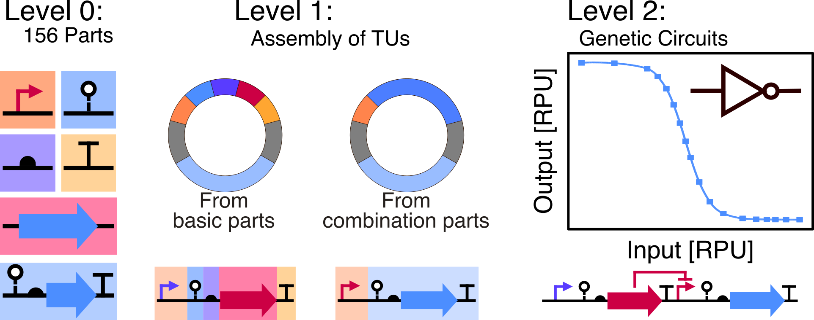

# The Coli Toolkit (CTK): An extension of the modular Yeast Toolkit for use in _E. coli_


This repository provides the code and data corresponding to the paper [**The Coli Toolkit (CTK): An extension of the modular Yeast Toolkit to the E. coli chassis**](https://pubs.acs.org/doi/10.1021/acssynbio.5c00489)
 by **Jacob Mejlsted<sup>1,2,3</sup>, Erik Kubaczka<sup>1,3</sup>, Sebastian Wirth<sup>1,3</sup>, and Heinz Koeppl<sup>1,3***</sup>, currently available in at at ACS Synthetic Biology.

1. Centre for Synthetic Biology, TU Darmstadt, Darmstadt 64283, Germany
2. Graduate School Life Science Engineering, TU Darmstadt, Darmstadt 64283, Germany
3. Department of Electrical Engineering and Information Technology, TU Darmstadt, Darmstadt 64283, Germany \
*Corresponding author


## Overview
The repository is separated into three main parts:
1. Flow cytometry data
2. Clustering of *de novo* DNA fragments 
3. Flow cytometry analysis and model calibration

## Abstract
Genetic circuits are a cornerstone of synthetic biology, enabling programmable control of cellular behavior for applications in health, sustainability, and biotechnology. While Genetic Design Automation (GDA) tools have optimized and streamlined the design of such circuits, rapid and efficient assembly of DNA remains a bottleneck in the DBTL cycle. Here we present the Coli Toolkit (CTK), a modular Golden Gate-based cloning system, adapted from the Yeast Toolkit (YTK) for use in Escherichia coli. The CTK expands on the original YTK architecture by introducing a more flexible control of transcription and translation through subdividing the former promoter part into subparts; promoter, insulating ribozyme, and ribosome binding site (RBS). We provide a range of basic parts that enable the assembly of a wide range of constructs, as well as characterization data for all constitutive and inducible promoters provided. Additionally, we provide characterization data for all 20 NOT gates from the Cello library, and we provide the NOT gates as preassembled basic parts, which enables rapid cloning of larger genetic circuits. With this toolkit, we leverage the strengths of the YTK architecture to enable rapid and high-efficiency assembly of genetic circuits in E. coli, filling a key gap in the infrastructure of bacterial synthetic biology.


_Visual Abstract_

## Flow cytometry data
The flow cytometry data presented in the paper and used for model calibration can be found in the directory `data`. `data` itselfis separated into a directory per replicate, while each replicate directory features the data for all constructs under characterized experimentally, divided according to their function. 
```
.
└── data/
    ├── replicate 1/
    │   ├── basal
    │   ├── constitutive
    │   ├── gates
    │   ├── inputs
    │   └── inputs_cross_reactivity
    ├── replicate 2/
    │   └── ...
    └── repliate 3/
        └── ...
```

## Clustering of *de novo* DNA fragments

The Python executable [DNA_fragments.py](DNA_fragments.py) performs clustering and grouping of *de novo* DNA fragments meant for synthesis. From the methods:

>The clustering software uses the Levenshtein similarity matrix to compute the differences between the various fragments that the user wants to synthesize. Using affinity propagation, the software defines clusters with high sequence similarity. From this, groups are made of up to three sequences from distinct clusters to obtain low sequence similarity in the final DNA sequence sent for synthesis. If the aggressive clustering option is selected, groups only containing one sequence are concatenated together to minimize the amount of DNA needed to be synthetized. Following the grouping, the DNA sequences are concatenated and the restriction sites for BsmBI are exchanged to BbsI and BspMI for the second and third occurrences, respectively. The final sequence is then outputted as a .csv file to the same folder as the input file was chosen from.
### Setup
Please make sure that you have a working Python installation. The requirements and instructions on their installation can be found in [Requirements](#requirements). 

Alternatively, the DNA clustering software is also available using pip using `pip install DNA-fragment-clustering`

### Input format

The input .csv files were based on the output format of Benchling. Examples are provided in the `clustering_sample_data` folder. 
The format uses three columns: **Name**, **Author**, **Sequence**
These are the name of the DNA fragment, the author/owner of the DNA sequences, and sequence in question, respectively. 

## Flow cytometry analysis and model calibration
The code for loading, preprocessing and analyzing the flow cytometry data is provided jointly with the code for model calibration in the Python notebook [ColiToolKit_Flow_Cytometry_Analysis_and_Model_Calibration.ipynb](ColiToolKit_Flow_Cytometry_Analysis_and_Model_Calibration.ipynb).

To use the code to either reproduce the analyzis and figures or to calibrate your own models, simply execute the Python notebook in the same directory as the `data` folder is in.
It is possible to use the notebook with your own data. If so, please make sure that it matches the directory layout as presented in `data`.

### Setup
You have to install the Jupyter notebook prior to the usage of [ColiToolKit_Flow_Cytometry_Analysis_and_Model_Calibration.ipynb](ColiToolKit_Flow_Cytometry_Analysis_and_Model_Calibration.ipynb).
You can do so by executing in your terminal or command line.
```
pip install notebook
```
Please note, that depending on your OS, you might have to use `pip3` instead of `pip`.

To provide the Python installation all the packages required to execute the provided code, please follow along the steps in [Requirements](#requirements) to add the dependencies.

The Jupyter notebook itself can be executed in the terminal or command line via 
```
jupyter notebook
```
This opens a browser window with a directory view from which you can navigate to the directory of this project.
Double clicking on the notebook opens it and allows you to execute it.
Further information on Jupyter notebooks can be found at [https://jupyter.org/](https://jupyter.org/).

## Requirements
The software provided here is written in Python and makes use of libraries such as numpy, pandas and others. 

Navigate with in your terminal or command line to project directory and run
```
pip install -r requirements.txt
```
to install all the dependencies required for the code. 
Be aware, that depending on your OS, you might have to use `pip3` instead of `pip`.

In particular, this installs the following packages:
```
numpy
pandas
Levenshtein
sklearn.cluster
pathlib
tkinter
matplotlib
FlowCal
scipy
shutil
warnings
```


## Citation
If you use this code or the data provided here, please cite the corresponding paper. 


## License
The code and the data is available under an MIT License. Please cite the corresponding preprint if you use our code and/or data.

## Funding & Acknowledgments
The authors acknowledge Anika Kofod Petersen for her work on the prototype of the _de novo_ synthesis clustering pipeline. 
The work was made possible with the support of a scholarship from the German Academic Exchange Service (DAAD), project number 91877921 to J.M. E.K. was supported by ERC-PoC grant PLATE (101082333). Any opinions, findings, and conclusions or recommendations expressed in this material are those of the author(s) and do not necessarily reflect the views of the funding agencies.
We acknowledge the use of Python and the aforementioned Python packages.
